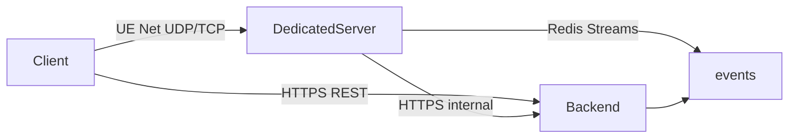

# Comunicação Client / DS / Backend

## Canais

| Canal | Transporte | Conteúdo |
|-------|------------|----------|
| Client ↔ DS | Unreal networking nativo | Inputs, replicação, RPCs de gameplay |
| Client ↔ API | HTTPS REST | Auth, join, meta (clã/loja fora de combate) |
| DS ↔ API | HTTPS + `x-internal-token` | validate-join, commits, heartbeats, checkpoints |
| Eventos assíncronos | Redis Streams `survival:game-events` | Fan-out interno / auditoria |

## Não trafegar no backend

- Movimento por frame  
- Traces brutos de combate  
- Física  

gRPC fica como evolução opcional; o MVP usa HTTPS interno estruturado com Zod.
