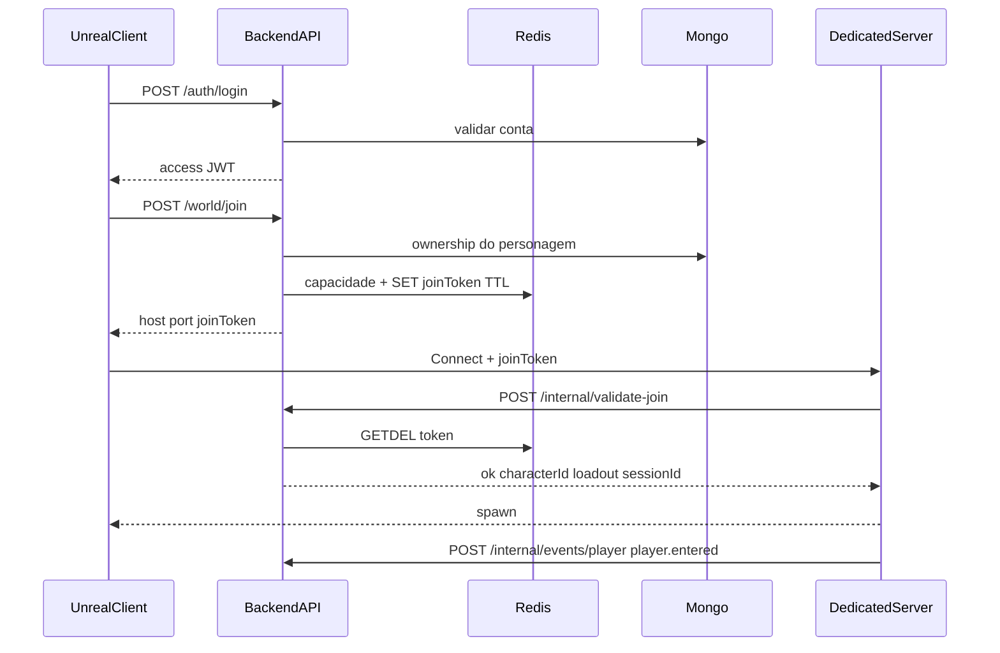

# Fluxo de conexão do jogador

## Regras

| Caso | Comportamento |
|------|----------------|
| Token expirado | DS rejeita; client pede novo `/world/join` |
| Token reutilizado | `already_used` |
| Sessão duplicada | Nova sessão substitui; DS deve kickar a anterior (`kickedPreviousSession`) |
| Queda do DS | Health `degraded`/`offline`; restore snapshot + re-join |
| Desconexão | `player.left` limpa sessão ativa no Redis |
